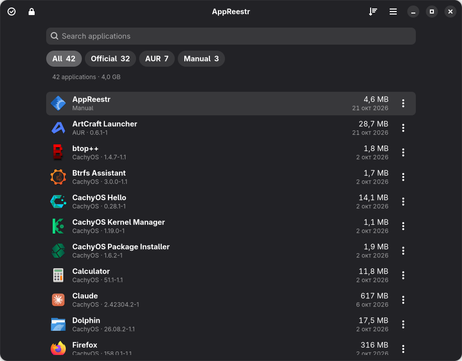

# AppReestr

[English](README.md) | **Русский**

[](https://github.com/12345qwert123456/AppReestr/actions/workflows/ci.yml)
[](LICENSE)



Реестр установленных приложений для Arch Linux и производных (CachyOS, Manjaro, EndeavourOS).
Как «Установленные приложения» в Windows: один список программ из всех источников, видно,
откуда каждая взялась, и её можно безопасно удалить.

## Что умеет

- **Один список** из всех источников: официальные репозитории Arch, репозитории дистрибутива
  (CachyOS, EndeavourOS, Manjaro), сторонние репозитории, AUR, Flatpak, AppImage, Snap и ручные
  установки (`/opt`, `/usr/local/bin`, распакованные архивы в домашней папке).
- **Только приложения.** Библиотеки, шрифты, ядра, драйверы и службы скрыты. Их показывает
  переключатель «Показать системное» (Ctrl+H), консольные утилиты — переключатель
  «Консольные утилиты» (Ctrl+J).
- **Одна программа — одна строка**, даже если она установлена несколькими способами (например,
  из репозитория и из Flatpak).
- **Карточка приложения**:
  - откуда установлено, когда и какой командой (по `pacman.log`);
  - где лежат файлы, что пришло вместе с программой;
  - почему программа попала в список.
- **Безопасное удаление** штатными средствами: `pacman -Rs`, `flatpak uninstall`, `snap remove`.
  - Перед удалением видно, что уйдёт вместе с программой.
  - Ядро, базовая система, загрузчик, текущий рабочий стол и экран входа защищены.
  - Каскадное удаление (`-Rc`) не используется никогда.
- **Массовое удаление.** Кнопка с галочкой в заголовке включает режим выбора: отметьте несколько
  программ и нажмите «Удалить…». Программы, которые нельзя удалить (защищены или нужны другим),
  пропускаются с объяснением, остальные уходят одной операцией.
- **Режим администратора.** Кнопка с замком в заголовке перезапускает AppReestr от root: пароль
  спрашивается один раз, после этого удаление не просит его. Защита системы при этом не
  отключается.
- **Опасная зона** (Настройки → «Опасная зона» и карточка пакета): принудительное удаление
  любого пакета, как `pacman -Rdd`. Зависимости и защита игнорируются, перед удалением показано,
  что сломается, а подтвердить нужно вводом названия пакета.
- **Остатки** (настройки, данные, кэш в домашней папке) по желанию отправляются в корзину,
  с предпросмотром.
- **Ручная разметка**: «скрыть из списка» и «показывать как приложение» запоминаются.
- **Ненужные компоненты** после удаления: предлагается убрать то, что больше никому не нужно.
- **Без сети и телеметрии.** Для просмотра не нужны права администратора.
- Полностью управляется с клавиатуры, следует светлой/тёмной теме системы, интерфейс на
  русском и английском.

## Сборка и установка

Зависимости: `rust`, `gtk4`, `libadwaita`, `pacman` (libalpm), `polkit`, `gettext`.

```bash
git clone https://github.com/12345qwert123456/AppReestr
cd AppReestr
make
sudo make install
```

Или пакетом:

```bash
cd packaging && makepkg -si
```

Запуск из дерева исходников (без установки): `cargo run -p appreestr`. В отладочной сборке
удаление использует `target/debug/appreestr-helper`; pkexec спросит пароль с общим сообщением,
потому что политика polkit ещё не установлена.

## Тайлинговые оконные менеджеры (Hyprland, Sway, i3)

- **Пароль администратора.** Пароль спрашивает агент polkit вашего сеанса (hyprpolkitagent,
  polkit-gnome, встроенный агент оболочки вроде Noctalia и т. п.). Если агента в сеансе нет и
  `pkexec` сообщает об этом, AppReestr запускает штатный `pkttyagent` только для себя и
  показывает окно ввода пароля сам. Пароль передаётся polkit напрямую и нигде не сохраняется.
- **Светлая и тёмная тема** берутся из портала: нужен `xdg-desktop-portal-gtk` (или
  `-gnome`/`-kde`). Тему можно и выбрать вручную в настройках (Ctrl+,).

## Режим администратора

«Перезапустить от администратора» запускает `pkexec appreestr`; окно открывается заново, а старое
закрывается. Приложение работает от root, но список и настройки берутся из домашней папки
вашего пользователя (`PKEXEC_UID`), файлы в ней записываются от вашего имени, а корзина и
пользовательский Flatpak обслуживаются от вашего имени. Помощник `appreestr-helper` по-прежнему
проверяет всё сам и запускается напрямую, без pkexec. Политика polkit `…run-as-admin`
устанавливается вместе с программой; из дерева исходников pkexec спросит пароль с общим сообщением.

## Горячие клавиши

| Клавиши | Действие |
|---|---|
| набор текста / Ctrl+F | поиск |
| ↑ ↓, Enter | выбор, карточка приложения |
| Delete | удалить выбранное (в режиме выбора: все отмеченные) |
| Esc, Alt+← | назад / выйти из режима выбора / очистить поиск |
| Alt+1…8 | фильтр по источнику |
| Ctrl+H / Ctrl+J | системное / консольные утилиты |
| F5, Ctrl+R | обновить список |
| Ctrl+, | настройки |
| Ctrl+? | все горячие клавиши |

## Как устроено

| Часть | Что делает |
|---|---|
| `crates/core` | Без GUI: источники (`sources/`), классификация (`classify.rs`), склейка в приложения (`merge.rs`), защита (`protect.rs`), план удаления через libalpm (`plan.rs`), остатки (`leftovers.rs`) |
| `crates/app` | Интерфейс на GTK4 + libadwaita (Relm4) |
| `crates/helper` | `appreestr-helper` — единственная часть, работающая от root (через pkexec). Заново проверяет имена, план и защиту; удаляет штатными средствами |
| `crates/dump` | Служебная утилита: `appreestr-dump --all` показывает, что и почему попало в список; `--plan PKG`, `--leftovers APP-ID`, `--timings` |
| `data/rules/*.toml` | Правила классификации, репозиториев и защиты — правятся без перекомпиляции; свои дополнения можно класть в `~/.config/appreestr/rules.toml` |

Настройки и ручная разметка хранятся в `~/.config/appreestr/`, кэш — в `~/.cache/appreestr/`.

## Проверка

```bash
make check          # rustfmt, clippy, тесты, проверка .desktop и metainfo
cargo run -p appreestr-dump -- --timings --all
```

Проверка удаления от начала до конца на безвредных пакетах — в `tests/pkg/PKGBUILD`.

## Лицензия

GPL-3.0-or-later.
